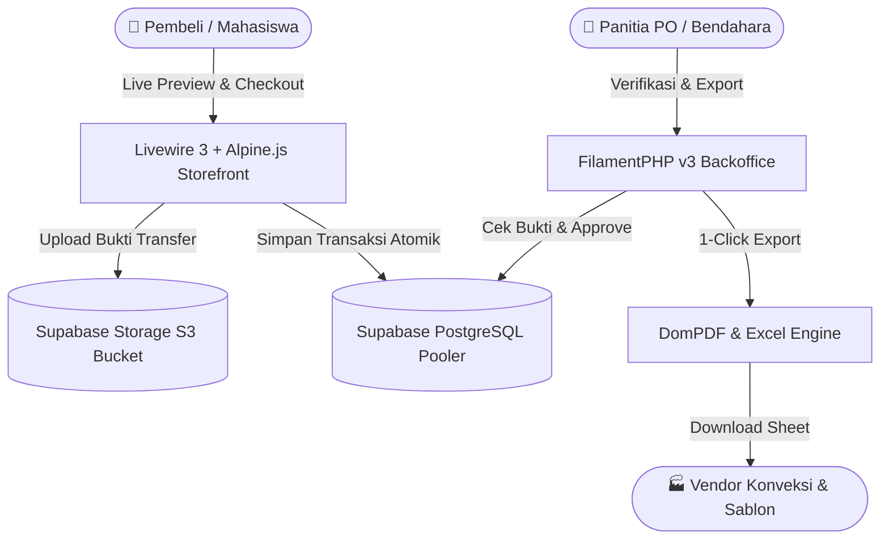

<div align="center">

# ⚽ PO-in Aja — Pre-Order Jersey & Merchandise Platform
### *iOS-Inspired Clean White & Royal Blue Edition &bull; Teknik Informatika Edition*

[](https://laravel.com)
[](https://livewire.laravel.com)
[](https://filamentphp.com)
[](https://tailwindcss.com)
[](https://alpinejs.dev)
[](https://supabase.com)
[](https://docker.com)

<p align="center">
  <b>Platform manajemen Pre-Order (PO) Jersey Komunitas & Organisasi Mahasiswa</b> yang dilengkapi dengan <i>Live Interactive Back-Jersey SVG Preview</i>, skema pembayaran bertahap (DP 50% vs Lunas 100%), pelacakan tahapan produksi publik secara real-time, dan otomasi ekspor lembar kerja konveksi vendor sekali klik.
</p>

</div>

---

## 💡 Latar Belakang & Masalah yang Diselesaikan

Dalam kepanitiaan pembuatan jersey angkatan / merchandise himpunan mahasiswa (HMIF), panitia sering kali menghadapi masalah manual:
1. **Pencatatan Nama/Nomor Typo:** Pembeli salah input atau panitia salah ketik saat menyalin dari Google Forms ke vendor jahit.
2. **Kekacauan Skema Pembayaran DP:** Sulit merekap siapa yang baru bayar DP 50% dan siapa yang sudah lunas, memicu selisih kas / piutang.
3. **Chat Berulang "Jersey-ku Sudah Sampai Mana?":** Panitia kewalahan membalas chat WhatsApp ratusan mahasiswa yang menanyakan status produksi.
4. **Rekap Manual Matriks Ukuran untuk Konveksi:** Vendor jahit membutuhkan rekap jumlah size (S/M/L/XL x Lengan Pendek/Panjang) dan daftar sablon terpisah yang rapi.

**PO-in Aja** menyelesaikan semua masalah di atas secara otomatis dalam satu ekosistem web modern.

---

## ✨ Fitur Unggulan

### 1. 👕 Storefront & Real-time SVG Jersey Preview (Tanpa Login)
- **iOS-Inspired Clean Aesthetic:** Desain minimalis dominan putih (`#F8FAFC`), sudut membulat lebar (`rounded-[32px]`), glassmorphism header, dan aksen warna *Royal Blue* (`#2563EB`).
- **Live Vector Preview (Alpine.js):** Saat pembeli mengetik *Nama Punggung* (maks 12 karakter) dan *Nomor Punggung* (maks 2 digit), teks di atas ilustrasi SVG punggung jersey otomatis berubah seketika tanpa refresh halaman.
- **Segmented Sleeve Switcher:** Pilihan Lengan Pendek vs Lengan Panjang otomatis memperpanjang lengan di ilustrasi jersey secara visual.
- **Dynamic Pricing Engine (Livewire 3):** Harga otomatis terkalkulasi saat memilih add-ons (contoh: Upgrade Kerah Polo Rib +Rp15k, Celana 1 Set +Rp50k, Ukuran XXL+ +Rp10k).

### 2. 💳 Split Payment Scheme (DP 50% vs Lunas 100%) & Cloud S3 Storage
- Pembeli dapat memilih skema:
  - **DP (50%):** Bayar separuh di awal untuk mengamankan slot pesanan.
  - **Lunas (100%):** Bayar penuh sekaligus.
- **Cloud S3 Upload:** Foto bukti transfer langsung disimpan ke bucket **Supabase Storage (S3 API)** sehingga aman dari container ephemeral (Koyeb/Render).
- Menghasilkan kode invoice publik unik (contoh: `PO-IF-2024`).

### 3. 🔍 Public Order & Production Timeline Tracker (`/track`)
- Pembeli cukup memasukkan Kode Invoice atau Nomor WhatsApp di halaman `/track`.
- Menampilkan visual progress tahapan produksi:
  $$\text{Open PO} \longrightarrow \text{Naik Cetak \& Sablon} \longrightarrow \text{Proses Jahit} \longrightarrow \text{Quality Control} \longrightarrow \text{Siap Diambil}$$
- **Otomasi Form Pelunasan:** Form upload bukti pelunasan otomatis muncul hanya jika status pesanan adalah `DP Paid` dan produksi telah masuk tahap `Quality Control` / `Siap Diambil`.

### 4. 🎛️ FilamentPHP v3 Backoffice & "1-Click Vendor Sheet"
- **Statistik Keuangan & Kuota:** Widget menghitung Total Kas Masuk, Total Piutang (sisa tagihan yang belum lunas), dan Progres Kuota Dipesan vs Target Minimum Vendor.
- **Verifikasi Bukti Transfer S3:** Preview modal foto bukti transfer dari cloud storage dengan tombol `Approve DP`, `Approve Lunas`, atau `Tolak`.
- **WhatsApp Direct Action:** Tombol 1-klik untuk langsung membuka WhatsApp chat dengan pesan templated otomatis ke nomor pemesan.
- **Export Lembar Kerja Konveksi:**
  - **PDF DomPDF:** Tabel Matriks Ukuran (*Size x Lengan Pendek vs Panjang*) + Tabel Sablon Punggung lengkap dengan kolom paraf serah terima PIC Konveksi.
  - **Excel Maatwebsite:** Format spreadsheet `.xlsx` siap kirim ke vendor.

---

## 🏗️ Arsitektur Teknologi & Free Cloud Stack



| Layer | Teknologi | Catatan Implementasi |
|---|---|---|
| **Framework** | Laravel 11 (PHP 8.2+) | Strict typing, PHP 8.2 Enums, Accessors, Action/Service Pattern |
| **Admin Panel** | FilamentPHP v3 | Customized Royal Blue theme, Table Actions, Dashboard Widgets |
| **Storefront** | Livewire 3 + Alpine.js | Mobile-First, iOS Segmented Controls, Reactive SVG Canvas |
| **Database** | Supabase PostgreSQL | `pgsql` via PgBouncer Transaction Pooler (Port `6543`) |
| **File Storage** | Supabase Storage (S3 API) | S3 Compatible API disk via `league/flysystem-aws-s3-v3` |
| **Export Engine** | `maatwebsite/excel` & `barryvdh/laravel-dompdf` | Matriks ukuran & lembar kerja sablon vendor |
| **Container** | Docker (Alpine + Nginx + PHP 8.3-FPM) | Zero-downtime, ephemeral-ready untuk Koyeb atau Render Free Tier |

---

## 🚀 Panduan Menjalankan di Lokal

### 1. Clone & Setup Repository
```bash
git clone https://github.com/vanoathalla/po-in-aja.git
cd po-in-aja
```

### 2. Install Dependensi PHP
```bash
composer install
```

### 3. Setup Environment
```bash
copy .env.example .env
php artisan key:generate
```

### 4. Setup Database & Seeder
Database default lokal menggunakan **SQLite** agar bisa langsung diuji tanpa setup cloud terlebih dahulu:
```bash
php artisan migrate --seed
```

> **Akun Admin Bawaan (Seeder):**
> - **URL Admin:** `http://127.0.0.1:8000/admin`
> - **Email:** `admin@po-in-aja.com`
> - **Password:** `password123`

### 5. Jalankan Server Lokal
```bash
php artisan serve
```
Buka browser:
- **Storefront Pemesanan:** [http://127.0.0.1:8000](http://127.0.0.1:8000)
- **Tracker Status Produksi:** [http://127.0.0.1:8000/track?invoice=PO-IF-2024](http://127.0.0.1:8000/track?invoice=PO-IF-2024)
- **Admin Panel:** [http://127.0.0.1:8000/admin](http://127.0.0.1:8000/admin)

---

## ☁️ Panduan Deployment Gratis (Koyeb / Render + Supabase)

1. **Supabase PostgreSQL:**
   - Dapatkan connection string Transaction Pooler (port `6543`) di menu **Settings &rarr; Database**.
   - Masukkan ke environment variable `DB_HOST`, `DB_PORT=6543`, `DB_USERNAME`, `DB_PASSWORD`.
2. **Supabase S3 Storage:**
   - Buat bucket bernama `po-in-aja` (centang *Public Bucket*).
   - Dapatkan Access Key & Secret Key di menu **Storage Settings &rarr; S3 Access Keys**.
   - Masukkan ke `AWS_ACCESS_KEY_ID`, `AWS_SECRET_ACCESS_KEY`, `AWS_BUCKET=po-in-aja`, `AWS_ENDPOINT=https://PROJECT_REF.supabase.co/storage/v1/s3`.
3. **Deploy Container:**
   - Hubungkan repository GitHub ini ke **Koyeb** atau **Render** (pilih type **Docker**).
   - Masukkan variable dari `.env.example`.
   - Script `entrypoint.sh` akan otomatis mengeksekusi `php artisan migrate --force`, `filament:optimize`, dan `config:cache` saat booting.

---

## 📄 Lisensi
Proyek ini dibuat untuk portofolio dan keperluan komunitas, dirilis di bawah lisensi [MIT](LICENSE).
